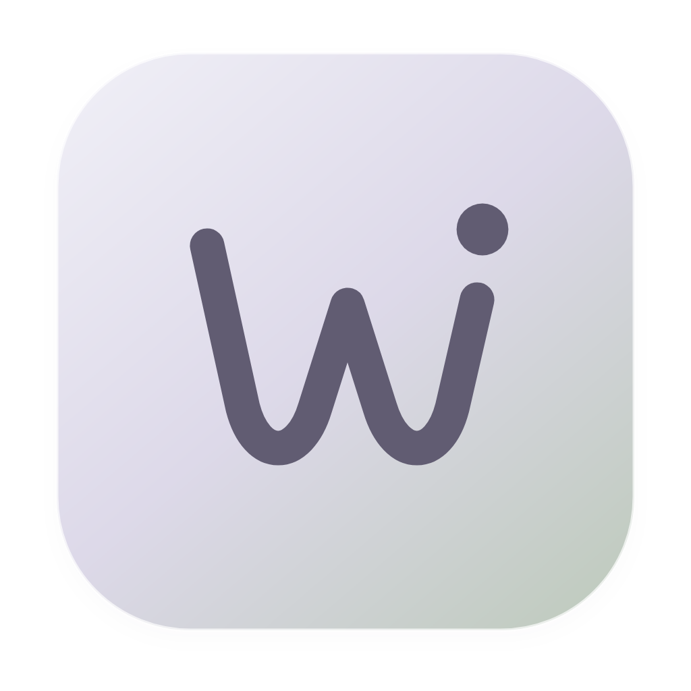
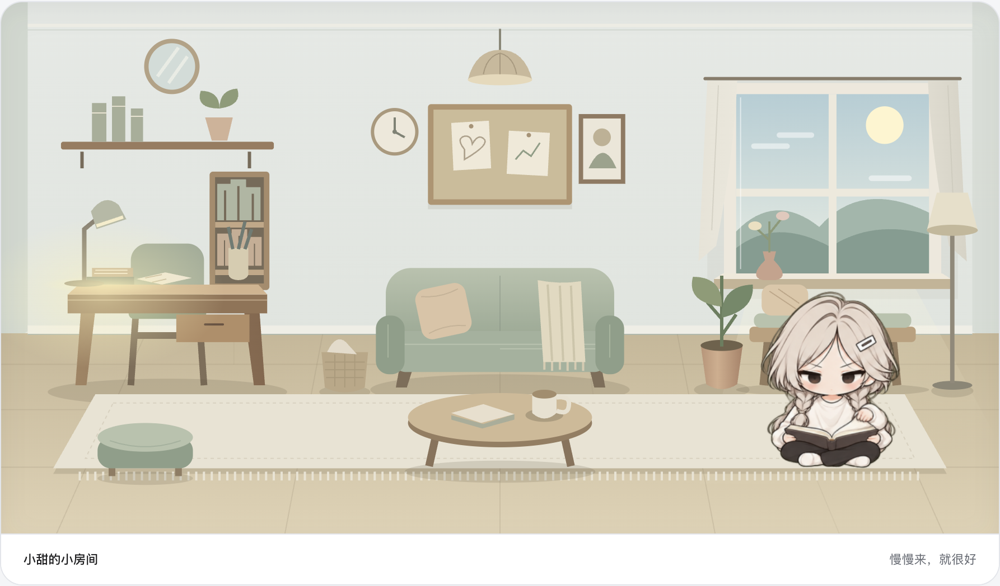

  
  <h1>WithU</h1>
  
<strong>在你的桌面，留一小块陪伴的位置。</strong>

  
聊聊今天，布置小窝，忙的时候安静陪着你。

  

    
    
    
  

  

    <a href="https://github.com/Sunny5250/WithU/releases/download/v2.2.0/WithU-2.2.0-macOS-arm64.dmg"><strong>下载 macOS 2.2.0</strong></a>
    &nbsp; · &nbsp;
    <a href="https://github.com/Sunny5250/WithU/releases/download/v2.1.2/WithU-2.1.2-Windows-x64-Setup.exe"><strong>下载 Windows 2.1.2</strong></a>
  

> **macOS 首次打开**：当前安装包尚未经过 Apple 公证，首次启动可能出现“Apple 无法验证”的提示。请先核对下载来源和文件摘要，再根据自己的信任决定是否[手动批准打开](https://github.com/Sunny5250/WithU/blob/main/docs/macos-first-open.md)。

 

## macOS 2.2.0 更新

主要入口整理为“对话、任务、记忆、互动”。新增按需联网、Bing 机票展示报价查询和“帮我盯着”关注任务；主动闲聊与近期趣事的比例可以调节，低状态时伙伴会自己吃饭和小憩。来源收进气泡内，未读角标、导航与日常互动布局同步完善。

[查看 macOS 2.2.0 发布说明](https://github.com/Sunny5250/WithU/releases/tag/v2.2.0)。Windows 当前正式版为 2.1.2，2.2.0：coming soon。

## 👋 今天，也一起慢慢来

桌面不只有文件和待办，也可以住着一个小伙伴。

一个脑洞、一点烦恼，或刚刚遇见的小确幸，都可以顺手告诉它。它会接住你的话题，偶尔连着说上几句，再送来一张恰到好处的表情。

认真聊正事，也欢迎闲聊和发呆。

## 🏡 小房间，装下你们的小日常

选一个喜欢的形象，给伙伴起个名字，再为彼此换上喜欢的头像。桌椅、沙发、绿植、灯光与配色，可以慢慢搭配，把屏幕里的小角落布置得舒服一点。

看它坐一会儿、喝杯东西。摸摸头，递块点心，碰个杯，心情、饱腹和精力也会跟着这些小互动发生变化。

## 💬 不止文字，也分享眼前的世界

双击桌宠，就能在桌面的小对话框里聊起来。发张照片、搜个表情、分享一份文件，都不用特意打开主界面。伙伴会和你一起聊聊画面里的细节，也会用图片和表情接住你的话题。

它偶尔也会从网上带回有趣的图片，配上一句“你看这个……”，一个新话题就这样开始了。

想一起看看某个网页或应用窗口时，可以先预览截图，再由你确认分享。眼前的小发现，也能成为你们共同的话题。

## 🌱 相处久了，慢慢熟悉彼此

你的习惯、喜欢的话题，还有一起经历的小片刻，会慢慢留在相处记忆里。

这些记忆可以随时查看、修改和忘记。想留下什么，由你决定。

## 🎲 休息五分钟，也有小节目

来一局石头剪刀布，或者掷骰子玩真心话大冒险；抽张今日小签，收集一点小惊喜。

需要收心的时候，就一起开始一段专注。那些容易忘的小事，也可以交给提醒来记着。

## ✨ Liquid Glass，轻盈的新模样

WithU 2.0.0 为 Mac 带来了原生 Liquid Glass，也为 Windows 更新了仿 Liquid Glass 界面。通透的层次、柔和的光影，以及切换时自然流动、轻轻回弹的玻璃选中框，让熟悉的陪伴多了一点灵动。玻璃质感跟随系统外观，也可以在设置中关闭。

布局、聊天和桌宠互动也一并打磨，让日常使用更顺手。

---

**连接与资料** · AI 聊天可使用已有的 ChatGPT 订阅，也可选择 OpenAI API 或 DeepSeek API。聊天、记忆和房间资料保存在本机；你分享的内容会随相关 AI 请求发送给服务提供方。截图由你预览确认后分享。

备份互通：2.0.0 版本应用可导入旧版备份；但 2.0.0 版本应用的新备份不能回导到 1.0.1。

  
Mac · macOS 13+ / Apple Silicon　｜　Windows · 10 / 11 / x64

  
<a href="https://github.com/Sunny5250/WithU/releases/latest">🎁 看看最近的新变化</a>

  
愿你的桌面，多一点恰好的陪伴。

